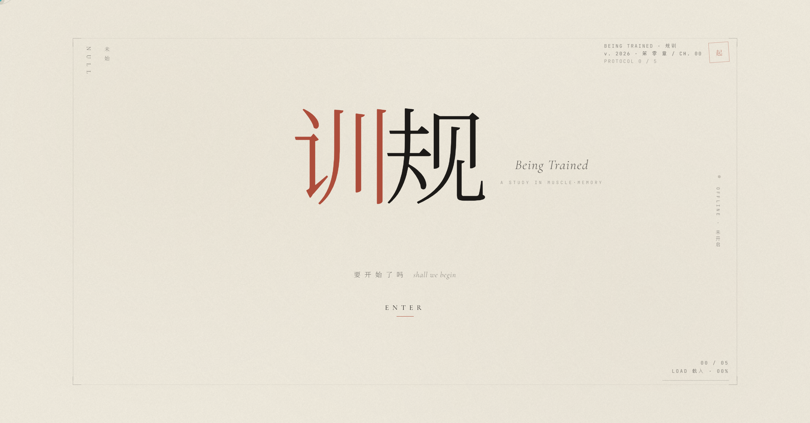
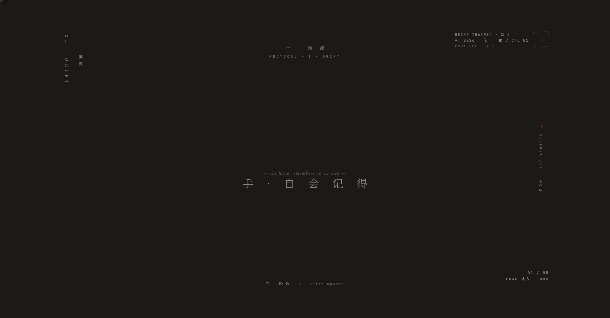
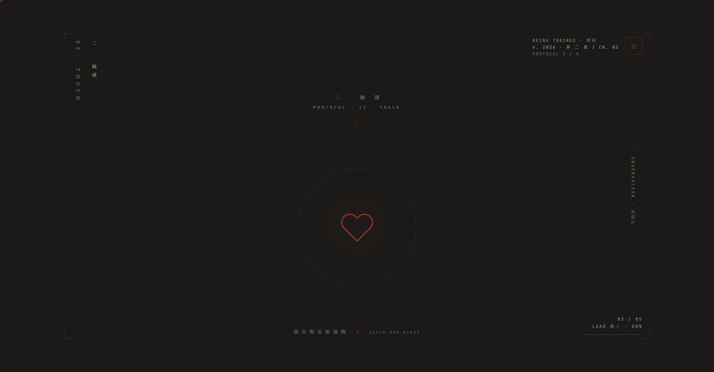
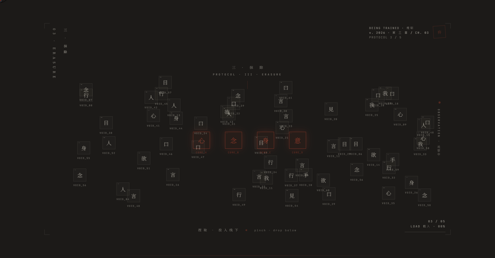
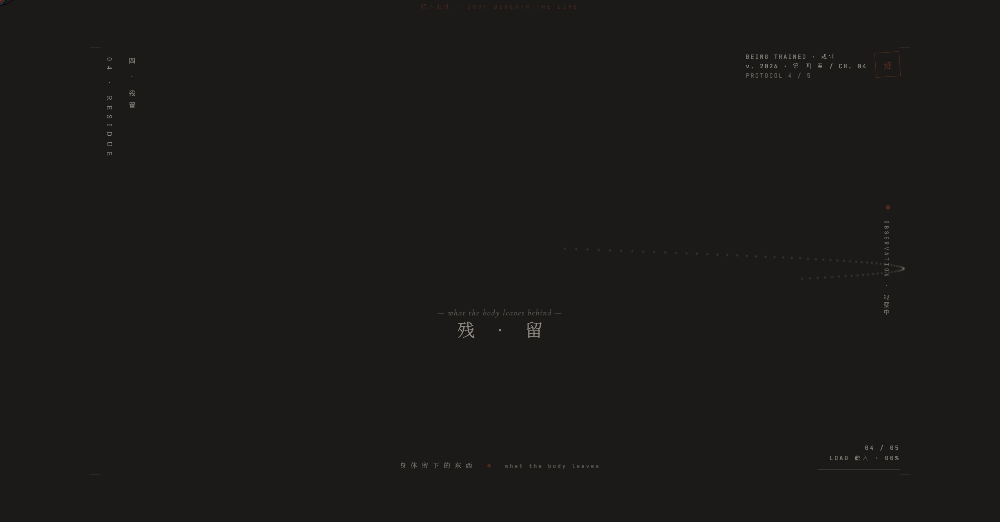

# Being Trained · 规训

一件围绕肌肉记忆、重复动作与身体习惯的浏览器交互作品。观众经过「漂流 → 触碰 → 抹除 → 残留」，最终回到一个可以重新开始的循环。

**[在线体验](https://being-trained.onrender.com)** · [交互说明](#交互方式)



## 快速开始

1. 使用带摄像头的电脑打开在线体验，点击 **Enter**。
2. 允许网站使用摄像头，把手放到镜头内，保持光线充足。右侧出现「OBSERVATION · 观察中」表示摄像头已启动，不代表每一帧都识别到了手。
3. 按下表体验各阶段。也可以用方向键或滚轮浏览整个流程。
4. 结束时点击 **Again**，重置进度并返回首页。

## 交互方式

以下说明依据当前 `engine.js` 的实际实现。

| 阶段 | 摄像头 / 手势操作 | 反馈与推进 |
| --- | --- | --- |
| 0 · 未始 | 首次进入用鼠标点击 Enter | 启动体验，进入漂流并请求摄像头权限 |
| 1 · 漂流 | 只伸出食指，其他手指收起，向上轻拨 | 生成文字粒子，积累进度；达到阈值后进入触碰 |
| 2 · 触碰 | 只伸出食指，将指尖对准中央心形并朝镜头前伸 | 深度及命中条件满足时产生心形粒子、声音并积累进度 |
| 3 · 抹除 | 食指停在字块上约 0.7 秒，抓取后向下移动 | 越过屏幕高度约 82% 的位置即投放；清除全部红色目标后进入残留 |
| 4 · 残留 | 无需操作 | 回放此前记录的手部轨迹，完成后自动进入终章 |
| 5 · 已习得 | 点击 Again；摄像头仍开启时，也可将指尖移到按钮并拇指、食指合拢 | 重置并返回首页 |

**界面提示与实现差异：** 触碰阶段虽显示“pinch and press”，实际判断是单食指姿态与指尖深度；抹除阶段虽显示“pinch”，实际采用悬停计时抓取，不要求捏合。拇指与食指合拢会触发涟漪等反馈，但不等同于触碰阶段的进度条件。

### 键盘与鼠标

- `↓` / `空格`：下一阶段；`↑`：上一阶段。
- 滚轮向下 / 向上：下一阶段 / 上一阶段，滚轮切换有约 1.5 秒间隔。
- 抹除阶段：按住字块约 0.6 秒后移动鼠标抓取，拖到屏幕下方并松开。
- 鼠标和键盘可以用于浏览及抹除操作，但不是前两个阶段手势识别的完整替代。
- 未记录到手部轨迹时，残留阶段会生成预设曲线，不应将它当作真实动作记录。

## 演示过程

以下是线上版本的实际页面截图，通过键盘切换阶段采集，展示界面流程，并非真人手势成功识别的实测记录。

### 1. 漂流：向上轻拨



### 2. 触碰：指向中央心形



### 3. 抹除：抓取并投放字块



### 4. 残留：动作留下的轨迹

残留阶段先回放轨迹，随后进入终章。



## 本地运行

这是无需编译的静态网站。安装 Python 后，在项目目录执行：

```sh
python -m http.server 8000
```

访问 http://localhost:8000 。不要直接双击 HTML：外部 JSX 加载与摄像头权限需要合适的网页运行环境。线上使用 HTTPS，本地使用 localhost。

## 文件与技术

| 文件 | 用途 |
| --- | --- |
| `index.html` | 页面结构及外部依赖入口 |
| `engine.js` | 阶段切换、手部识别、粒子、拖拽、轨迹和音效 |
| `styles.css` | 排版、配色与视觉效果 |
| `tweaks-panel.jsx` / `tweaks.jsx` | 参数调节界面 |
| `demo-*.png` | 演示截图 |

使用原生 JavaScript、Canvas、Web Audio、MediaPipe Hands，以及 React / Babel 参数面板。字体与部分脚本、模型从外部 CDN 加载，需要网络访问。

## Render 部署

- 类型：Static Site
- 分支：`main`
- Build Command：`echo Static site ready`
- Publish Directory：`.`

## 排查与验证范围

摄像头无法启动时，检查站点权限、设备是否被其他程序占用，以及 MediaPipe CDN 是否可访问。手势不触发时，检查手是否完整入镜、食指姿态、目标位置与前伸动作；可先用键盘切换确认页面流程。

已检查核心 JavaScript 语法、公开页面加载与阶段截图。真人手势识别准确率、不同设备和浏览器的完整流程仍需实际体验验证。当前代码未包含视频上传接口；第三方资源仍会产生网络请求。
